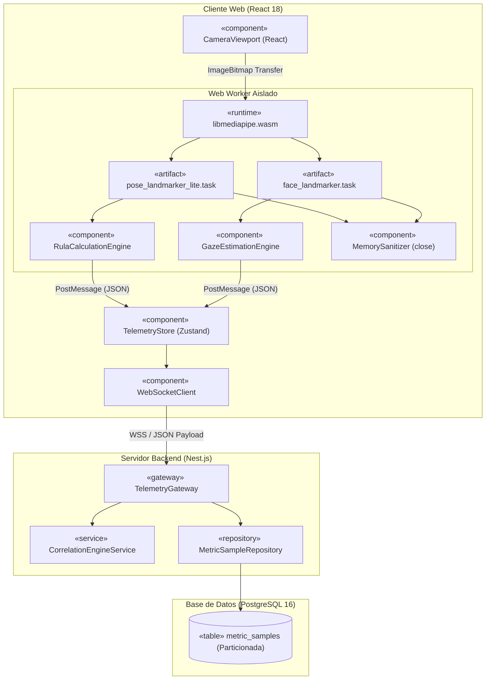
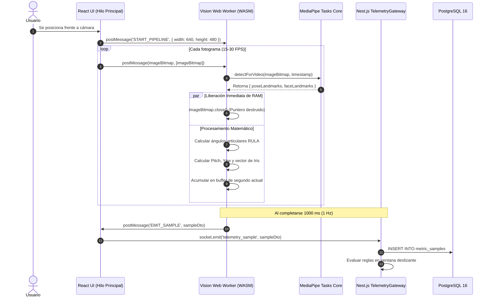

# ErgoCheck AI — Arquitectura y Funcionalidades del Subsistema de Inteligencia Artificial

> **Proyecto:** ErgoCheck AI: Plataforma Inteligente de Evaluación Postural y Prevención de Riesgos Ergonómicos Mediante Visión Artificial 2D  
> **Institución:** Universidad Autónoma Gabriel René Moreno (UAGRM) — FICCT  
> **Materia:** Ingeniería de Software 1 (INF-422) — Grupo #1  
> **Docente:** Ing. Rolando Antonio Martínez Canedo  
> **Gestión:** Semestre 2 - 2026  
> **Metodología de Trabajo:** SCRUM  
> **Estándar de Modelado:** UML 2.5+ (OMG / Enterprise Architect)  
> **Stack Oficial:** React (Web), React Native (Móvil), Nest.js (Backend), PostgreSQL 16 (BD), MediaPipe Tasks Vision (IA Edge)

---

## Integrantes del Grupo #1

| Integrante | Registro |
|---|---|
| Camacho Jimenez Jairo Lisandro | 222053348 |
| Lopez Velazquez Marco Alejandro | 222008891 |
| Matienzo Flores Juan Manuel | 222008970 |
| Moreno Gonzales Jerson Alexander | 221180508 |
| Orellana Escobar Isaac | 222056541 |

---

## Estructura del Documento

Este documento se divide en **dos grandes bloques maestros e independientes**:
- **[BLOQUE 1: ARQUITECTURA DE LA INTELIGENCIA ARTIFICIAL](#bloque-1-arquitectura-de-la-inteligencia-artificial):** Topología, modelos de redes neuronales, pipeline de ejecución en memoria, gestión de privacidad, integración técnica y modelado formal UML 2.5+.
- **[BLOQUE 2: FUNCIONALIDADES PRINCIPALES DEFINIDAS POR LA IA](#bloque-2-funcionalidades-principales-definidas-por-la-ia):** Catálogo exhaustivo de capacidades del sistema (Entradas $\to$ Procesamiento $\to$ Salidas $\to$ Reglas de Negocio) divididas en Módulo Ergonómico, Módulo de Supervisión/Proctoring y Módulo de Correlación.

---

# BLOQUE 1: ARQUITECTURA DE LA INTELIGENCIA ARTIFICIAL

Este bloque define la estructura estática, dinámica y de despliegue del subsistema de IA, demostrando cómo se distribuye el cómputo entre el cliente y el servidor sin transmitir video.

---

## 1.1 Topología Híbrida: Edge AI (Cliente) vs. Cloud (Servidor)

La arquitectura de IA de ErgoCheck AI adopta el paradigma **Edge-to-Cloud**, separando estrictamente la visión artificial del análisis de correlación:

```mermaid
flowchart LR
    subgraph Edge["1. Borde / Cliente (Navegador React 18)"]
        direction TB
        CAM["Webcam Local"] --> FRAME["Frame en Memoria (OffscreenCanvas)"]
        FRAME --> WORKER["Web Worker (WASM)"]
        WORKER --> MP["MediaPipe Pose + Face Mesh"]
        MP --> MATH["Cálculo Trigonométrico & RULA"]
        MATH --> GC["Destrucción Inmediata de Frame (close)"]
        MATH --> JSON_OUT["Vectores Numéricos JSON (1 Hz)"]
    end

    subgraph Transport["2. Transporte Seguro"]
        JSON_OUT -->|"WSS (TLS 1.3) / ~450 Bytes/s"| WS_NET["Canal WebSocket"]
    end

    subgraph Cloud["3. Nube / Backend (Nest.js + PostgreSQL)"]
        direction TB
        WS_NET --> GATEWAY["TelemetryGateway (@nestjs/websockets)"]
        GATEWAY --> CORR_ENGINE["CorrelationEngineService"]
        CORR_ENGINE --> RULES["Evaluador de Reglas Temporales"]
        RULES --> DB[("PostgreSQL 16 (Series Temporales)")]
    end
```



### Justificación de la Topología:
1. **Frontera de Visión en el Borde (Edge):** La inferencia neuronal pesada sobre video ocurre en la GPU/CPU del cliente mediante WebAssembly y WebGL. El servidor no procesa imágenes, lo que reduce el costo de infraestructura en la nube a casi cero en cómputo de GPU.
2. **Frontera de Correlación en el Servidor (Cloud):** Nest.js recibe únicamente estructuras ligeras JSON con escalares (ángulos, booleanos y marcas de tiempo). El servidor almacena las series temporales y cruza eventos para evaluar incidentes.

---

## 1.2 Modelos de Redes Neuronales Integrados

Los modelos seleccionados corresponden a la suite oficial de **Google MediaPipe Tasks Vision**, optimizados en formato TFLite para ejecución local sobre navegadores Chromium y Firefox:

| Parámetro | Modelo 1: Pose Corporal | Modelo 2: Malla Facial & Blendshapes |
|---|---|---|
| **Identificador** | `MediaPipe PoseLandmarker (BlazePose Lite)` | `MediaPipe FaceLandmarker (FaceMesh)` |
| **Artefacto Binario** | `pose_landmarker_lite.task` | `face_landmarker.task` |
| **Tamaño en Disco / Red** | ~9.2 MB | ~4.5 MB |
| **Salida Numérica** | **33 landmarks** articulares 3D $(x, y, z)$ | **478 landmarks** 3D + **52 blendshapes** |
| **Motor de Ejecución** | WebAssembly (WASM) + WebGL / WebGPU | WebAssembly (WASM) + WebGL / WebGPU |
| **Tasa de Inferencia** | 15 a 30 FPS en hilo secundario | 15 a 30 FPS en hilo secundario |
| **Consumo de Memoria** | ~65 MB en RAM | ~50 MB en RAM |

---

## 1.3 Pipeline de Ejecución y Destrucción de Fotogramas (Zero-Image Leakage)

El flujo de procesamiento en memoria garantiza que **ninguna imagen salga jamás del dispositivo del usuario**:

```
[Captura Webcam] 
       │ 
       ▼ (requestVideoFrameCallback)
[Objeto ImageBitmap / OffscreenCanvas] 
       │
       ▼ (Transferencia de puntero sin copia a Web Worker)
[Inferencia MediaPipe PoseLandmarker & FaceLandmarker]
       │
       ├────────────────────────────────────────┬────────────────────────────────────────┐
       ▼                                        ▼                                        ▼
[Cómputo Biomecánico RULA]             [Cómputo Euler & Iris]               [Destrucción del Fotograma]
(Ángulos Cuello, Tronco, Hombros)       (Pitch, Yaw, Gaze Ratio)             ImageBitmap.close() -> RAM liberada
       │                                        │                                        │
       └────────────────────────────────────────┴────────────────────────────────────────┘
                                                │
                                                ▼
                             [Buffer de Agregación Temporal (1 s)]
                                                │
                                                ▼
                          [Serialización JSON -> WebSocket Nest.js]
```

---

## 1.4 Arquitectura de Integración (React + Web Workers + Nest.js)

1. **Capa Cliente (React 18):**
   - El componente de vista inicializa el worker instanciando `new Worker('./vision.worker.ts', { type: 'module' })`.
   - Se utiliza `HTMLVideoElement.requestVideoFrameCallback()` para capturar fotogramas sincronizados con el refresco de pantalla.
   - El estado local se gestiona mediante un store reactivo con **Zustand**.
2. **Capa Servidor (Nest.js):**
   - `@WebSocketGateway({ namespace: '/telemetry' })` gestiona conexiones simultáneas mediante adaptadores Socket.io o WS nativo.
   - Los datos entrantes se validan con `class-validator` y DTOs tipados.
   - `CorrelationEngineService` mantiene un buffer circular en memoria por sesión activa para evaluar ventanas temporales deslizantes.

---

## 1.5 Modelado UML 2.5+ de la Arquitectura de IA (Enterprise Architect)

### Diagrama de Componentes de la IA (UML Component Diagram)



### Diagrama de Secuencia: Inferencia y Ciclo de Vida del Frame (UML Sequence Diagram)



---

# BLOQUE 2: FUNCIONALIDADES PRINCIPALES DEFINIDAS POR LA IA

Este bloque describe detalladamente cada una de las funcionalidades de software que la IA implementa en el sistema, detallando sus **entradas, lógica matemática de procesamiento, salidas y reglas de negocio**.

---

## 2.1 Módulo Ergonómico y Salud Ocupacional (Modo Corporativo)

### F-01: Calibración Antropométrica Inicial Personalizada
- **Descripción:** Captura la postura neutra y altura de trabajo específica de cada usuario para eliminar sesgos derivados de la estatura, inclinación de la cámara o tipo de silla.
- **Entradas:** 3 segundos de landmarks continuos (90 fotogramas a 30 FPS) mientras el usuario mira al centro de la pantalla en postura erguida.
- **Procesamiento:**
  $$\overline{\theta}_{\text{cuello\_base}} = \frac{1}{N}\sum_{t=1}^N \theta_{\text{cuello}}(t), \quad \overline{\theta}_{\text{tronco\_base}} = \frac{1}{N}\sum_{t=1}^N \theta_{\text{tronco}}(t), \quad \overline{\text{Pitch}}_{\text{base}} = \frac{1}{N}\sum_{t=1}^N \text{Pitch}(t)$$
- **Salida:** Objeto `BaselineCalibration` almacenado en memoria local y persistido en `monitor_sessions.baseline_calibration`.
- **Regla de Negocio:** La sesión de monitoreo o examen no puede iniciar hasta que la calibración finalice con éxito (varianza de postura durante los 3 segundos $\sigma^2 \le 2.5^\circ$).

---

### F-02: Estimación Postural y Cálculo Ergonómico RULA Continuo en 2D
- **Descripción:** Evalúa cada segundo la postura de extremidades superiores, cuello y columna según el método RULA (McAtamney & Corlett, 1993) adaptado a cámara frontal 2D.
- **Entradas:** Coordenadas normalizadas $(x, y)$ de hombros (11, 12), codos (13, 14), muñecas (15, 16), orejas (7, 8) y caderas (23, 24).
- **Procesamiento Matemático:**
  1. **Ángulo de Flexión de Cuello ($\theta_{\text{cuello}}$):**
     $$\vec{u}_{\text{cuello}} = \text{Oreja Media} - \text{Hombro Medio}, \quad \theta_{\text{cuello}} = \arccos\left(\frac{\vec{u}_{\text{cuello}} \cdot \begin{pmatrix} 0 \\ -1 \end{pmatrix}}{\|\vec{u}_{\text{cuello}}\|}\right) \times \frac{180}{\pi}$$
  2. **Ángulo de Inclinación de Tronco ($\theta_{\text{tronco}}$):**
     $$\vec{u}_{\text{tronco}} = \text{Hombro Medio} - \text{Cadera Media}, \quad \theta_{\text{tronco}} = \arccos\left(\frac{\vec{u}_{\text{tronco}} \cdot \begin{pmatrix} 0 \\ -1 \end{pmatrix}}{\|\vec{u}_{\text{tronco}}\|}\right) \times \frac{180}{\pi}$$
  3. **Mapeo a Puntuaciones Tabulares RULA:**
     - Cuello: $0^\circ-10^\circ \to 1$; $10^\circ-20^\circ \to 2$; $>20^\circ \to 3$. Corrección por inclinación lateral de orejas: $+1$.
     - Tronco: $0^\circ-5^\circ \to 1$; $5^\circ-20^\circ \to 2$; $>20^\circ \to 3$.
     - Brazos/Codos: Flexión de codo calculada entre hombro, codo y muñeca.
     - Cruce en Tabla A (Brazos) y Tabla B (Cuello/Tronco/Piernas) para derivar la **Puntuación RULA Final (1 a 7)**.
- **Salidas:** Escalar entero $\text{RULA} \in [1, 7]$ emitido cada segundo.
- **Regla de Negocio:**
  - $\text{RULA } 1-2$: Estado Verde (Aceptable).
  - $\text{RULA } 3-4$: Estado Amarillo (Riesgo Bajo).
  - $\text{RULA } 5-6$: Estado Naranja (Riesgo Medio).
  - $\text{RULA } 7$: Estado Rojo (Riesgo Crítico).

---

### F-03: Detección de Postura Estática Prolongada y Fatiga Muscular
- **Descripción:** Identifica periodos prolongados donde el trabajador permanece inmóvil en una misma postura, lo que causa acumulación de ácido láctico y sobrecarga biomecánica articular.
- **Entradas:** Serie temporal de ángulos de cuello y tronco en los últimos 180 segundos.
- **Lógica de Procesamiento:** Si durante un intervalo $T \ge 60\text{ s}$ la variación angular de cuello y tronco permanece dentro de un rango estricto:
  $$|\theta(t) - \theta(t-1)| \le 2.0^\circ, \quad \forall t \in [T_0, T_0 + 60\text{ s}]$$
  Se añade $+1$ al puntaje RULA en concepto de **carga muscular estática**.
- **Salida:** Flag booleano `is_static_posture: true` en el payload de telemetría.

---

### F-04: Disparo Inteligente de Alertas y Notificaciones Preventivas
- **Descripción:** Mecanismo de intervención que avisa al usuario en la web o en su smartphone cuando supera los umbrales tolerables de riesgo postural.
- **Entradas:** Flujo continuo de puntajes RULA y temporizador acumulativo.
- **Reglas Operativas:**
  - **Alerta Web (Nivel 1):** Si $\text{RULA} \ge 5$ sostenido durante $> 120\text{ segundos}$, se renderiza una tarjeta flotante no intrusiva en React sugiriendo corregir la postura.
  - **Notificación Push Móvil (Nivel 2):** Si la postura no se corrige tras 300 segundos adicionales, Nest.js despacha un mensaje push mediante Firebase Cloud Messaging (FCM) a la app en **React Native**.

---

### F-05: Prescripción Dinámica de Pausas Activas Guiadas (React Native)
- **Descripción:** Recomienda rutinas interactivas de recuperación musculoesquelética en el teléfono móvil en función de la zona anatómica más castigada durante la jornada.
- **Entradas:** Registro de ángulos acumulados (p. ej. si prevaleció flexión de cuello o tensión en hombros).
- **Salida en App Móvil:** Carga de rutina animada de 2 minutos (estiramiento de trapecios, regla 20-20-20 de descanso visual o descompresión lumbar) con cronómetro y confirmación de ejecución (`BREAK_COMPLETED`).

---

## 2.2 Módulo de Supervisión, Atención y Anti-Cheat (Modo Evaluación / Proctoring)

### F-06: Estimación de Orientación Cefálica (Head Pose 3D) y Foco Visual
- **Descripción:** Determina la dirección hacia donde apunta la cabeza del usuario sin necesidad de sensores infrarrojos adicionales.
- **Entradas:** 6 puntos canónicos de la malla facial (nariz, mentón, cantos de ojos y comisuras de boca).
- **Procesamiento:** Resolución algorítmica del problema PnP (Perspective-n-Point) contrastando los puntos 2D contra un modelo antropométrico 3D rígido. Derivación de ángulos de Euler:
  - **Pitch ($\phi$):** Inclinación vertical (cabeceo hacia abajo/arriba).
  - **Yaw ($\psi$):** Giro horizontal (izquierda/derecha).
  - **Roll ($\gamma$):** Balanceo lateral hacia los hombros.
- **Salida:** Tupla de rotación tridimensional $(\text{Pitch}, \text{Yaw}, \text{Roll})$ en grados sexagesimales.
- **Regla de Negocio:** $|\text{Yaw}| > 30^\circ$ durante $> 3\text{ segundos}$ dispara el evento de advertencia `GAZE_OFFSCREEN` (mirada fuera de pantalla).

---

### F-07: Detección Vectorial de Dispositivos Ocultos (Sospecha de Celular en Regazo)
- **Descripción:** Detecta el patrón corporal característico de un estudiante que baja la mirada repetidamente hacia su regazo o escritorio para consultar un teléfono celular o apuntes no autorizados.
- **Entradas:**
  1. Ángulo de Euler $\text{Pitch}$ de la cabeza.
  2. Ratio vertical del iris $G_y = \frac{y_{\text{iris}} - y_{\text{párpado\_sup}}}{y_{\text{párpado\_inf}} - y_{\text{párpado\_sup}}}$.
  3. Contador de eventos de teclado en el cliente (`key_count`).
- **Lógica de Decisión (Cuarteto Condicional):**
  $$\text{Pitch}_{\text{efectivo}} = \text{Pitch} + 0.65 \cdot (G_y - 0.5) \cdot 60^\circ$$
  Se dispara el evento `GAZE_DOWN_SUSTAINED` **SI Y SÓLO SI**:
  1. $\text{Pitch}_{\text{efectivo}} < -20^\circ$ (cabeza y ojos dirigidos abajo).
  2. Duración continua $T \ge 2.0\text{ segundos}$.
  3. $\text{key\_count} = 0$ (el usuario no está digitando texto en el teclado).
  4. La ocurrencia se repite $\ge 3$ veces dentro de una ventana de 60 segundos.
- **Salida:** Incidente de alta severidad con evidencia cronometrada en el reporte forense.

---

### F-08: Auditoría de Presencia Facial (Ausencia y Múltiples Rostros)
- **Descripción:** Supervisa que el postulante permanezca frente a la terminal y que ninguna tercera persona ingrese al área visual para dictar respuestas.
- **Entradas:** Número de mallas faciales detectadas por `MediaPipe FaceLandmarker`.
- **Reglas de Negocio:**
  - **Rostro Ausente (`FACE_ABSENT`):** Cero rostros detectados con confianza $\ge 0.5$ durante $> 5.0\text{ s} \implies$ Dispara incidente de gravedad media/alta.
  - **Múltiples Rostros (`MULTIPLE_FACES`):** $\ge 2$ rostros detectados simultáneamente durante $> 1.0\text{ s} \implies$ Dispara incidente crítico de sospecha de acompañante.

---

### F-09: Auditoría de Navegación, Desenfoque de Ventana y Pantalla Completa
- **Descripción:** Monitorea la actividad del navegador para verificar que el usuario no salte a otras aplicaciones ni abra pestañas de búsqueda.
- **Entradas:** Eventos de W3C APIs: `visibilitychange`, `window.onblur`, `window.onfocus`, `fullscreenchange`.
- **Salidas:**
  - `WINDOW_BLUR`: Registra el instante exacto en que la pestaña perdió el foco.
  - `WINDOW_FOCUS`: Computa la duración neta transcurrida en milisegundos fuera de la plataforma (`duration_outside_ms`).
  - `FULLSCREEN_EXIT`: Bloquea temporalmente el examen con una alerta modal exigiendo reincorporación a pantalla completa.

---

### F-10: Análisis de Variabilidad Gestual Relativa en Preguntas Críticas
- **Descripción:** Registra las variaciones de tensión muscular superficial en el rostro frente a preguntas específicas (técnicas o psicotécnicas) para revisión humana objetiva.
- **Entradas:** Coeficientes normalizados $[0.0, 1.0]$ de los 52 blendshapes faciales de MediaPipe.
- **Procesamiento:** Cálculo de la diferencia respecto a la calibración neutra:
  $$\Delta b_{\text{tensión}} = \left(\frac{b_{\text{browDownLeft}} + b_{\text{browDownRight}}}{2}\right) - \text{baseline}_{\text{tensión}}$$
- **Salida:** Gráfico de radar en el reporte forense que muestra el delta de tensión muscular durante la lectura y respuesta de cada pregunta crítica.
- **Regla de Negocio:** Esta métrica es **puramente informativa y descriptiva**. No determina automáticamente sanciones ni calificaciones (garantía de ética algorítmica).

---

## 2.3 Módulo de Analítica, Correlación e Índices Sintéticos (Nest.js Backend)

### F-11: Motor de Correlación Temporal por Reglas Declarativas
- **Descripción:** Servicio asíncrono en Nest.js que procesa el flujo de eventos heterogéneos (postura + mirada + navegación) sobre ventanas temporales deslizantes.
- **Entradas:** Cola ordenada en memoria de `ActivityEvent` y `MetricSample` por cada sesión activa.
- **Salidas:** Entidades `Incident` persistidas en PostgreSQL con severidad asignada (`LOW`, `MEDIUM`, `HIGH`, `CRITICAL`), explicación en texto legible y lista de eventos que constituyen evidencia formal.

---

### F-12: Cómputo del Índice de Integridad y del Índice de Bienestar

#### A. Modo Evaluación: Índice de Integridad ($I_{\text{integridad}} \in [0, 100]$)
Cuantifica la probidad de una sesión de examen restando penalizaciones por incidentes confirmados:
$$I_{\text{integridad}} = \max\left(0,\; 100 - \sum_{k=1}^M (P_k \cdot n_k)\right)$$
- $P_{\text{ausencia}} = 15\text{ pts}$ por cada evento $> 10\text{ s}$.
- $P_{\text{multi\_rostros}} = 25\text{ pts}$ por cada ocurrencia.
- $P_{\text{salida\_pantalla}} = 10\text{ pts}$ por cada evento $> 5\text{ s}$.
- $P_{\text{celular\_regazo}} = 20\text{ pts}$ por cada patrón reincidente detectado.

#### B. Modo Corporativo: Índice de Bienestar Ergonómico ($I_{\text{bienestar}} \in [0, 100]$)
Cuantifica la salud postural acumulada durante la jornada laboral:
$$I_{\text{bienestar}} = \left( 0.40 \cdot \frac{T_{\text{RULA}\le 3}}{T_{\text{total}}} + 0.30 \cdot \frac{N_{\text{pausas\_completadas}}}{N_{\text{pausas\_sugeridas}}} + 0.30 \cdot \frac{T_{\text{foco\_activo}}}{T_{\text{jornada}}} \right) \times 100$$

---

### F-13: Consola de Supervisión en Tiempo Real (Mosaico React)
- **Descripción:** Cuadrícula interactiva en React donde supervisores y docentes observan el estado en vivo de hasta 50 puestos simultáneos por página.
- **Entradas:** Eventos emitidos por WebSocket desde Nest.js.
- **Salida:** Tarjeta individual por usuario con código de semáforo dinámico:
  - 🟢 **En Foco / Postura Óptima:** RULA 1-3, mirada al frente.
  - 🟡 **Distraído:** Mirada fuera de pantalla $> 5\text{ s}$ o inactividad.
  - 🟠 **Riesgo Ergonómico:** RULA $\ge 5$ sostenido.
  - 🔴 **Anomalía Crítica:** Salida de pantalla en examen, celular en regazo o múltiples rostros.
  - ⚫ **Desconectado:** Pérdida de heartbeat del socket.

---

### F-14: Generación Automatizada de Reportes Forenses y Ergonómicos (PDF / Excel)
- **Descripción:** Compilación de documentos oficiales descargables con validez de auditoría.
- **Entradas:** Series temporales agregadas de la sesión desde PostgreSQL.
- **Salidas:**
  - **Reporte Ergonómico SST (Empresas):** Gráficos de evolución RULA, porcentaje de tiempo en riesgo, balance de pausas activas y recomendaciones ergonómicas.
  - **Reporte Forense Individual (Exámenes):** Datos del evaluado, calificación, línea de tiempo de pérdidas de foco, incidentes de mirada al regazo con marcas de tiempo e Índice de Integridad global.
