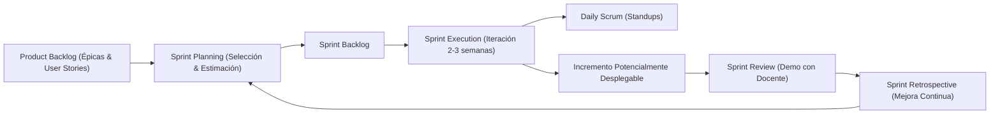
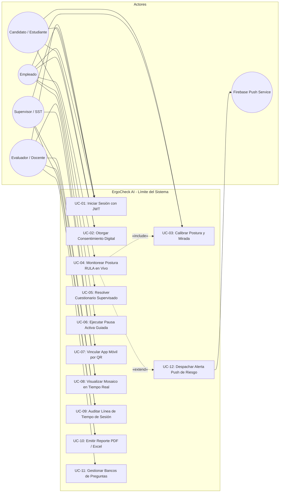
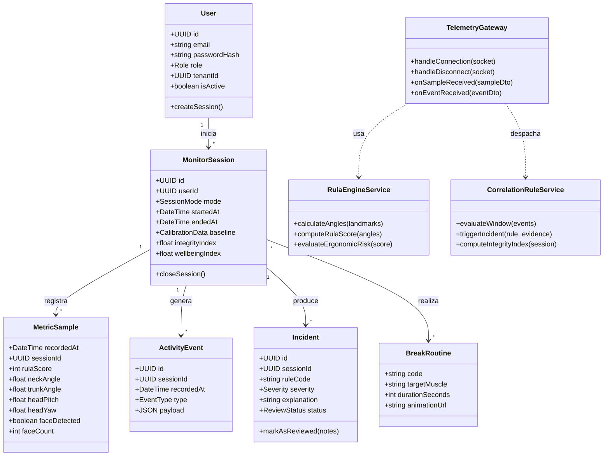
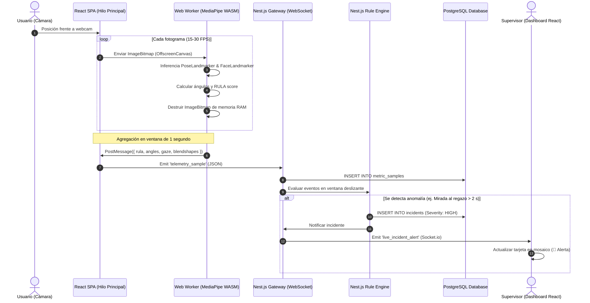
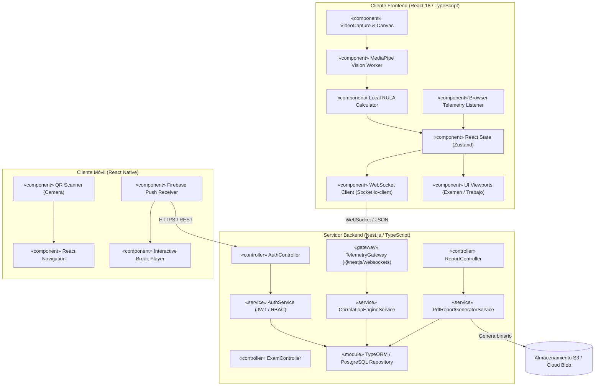
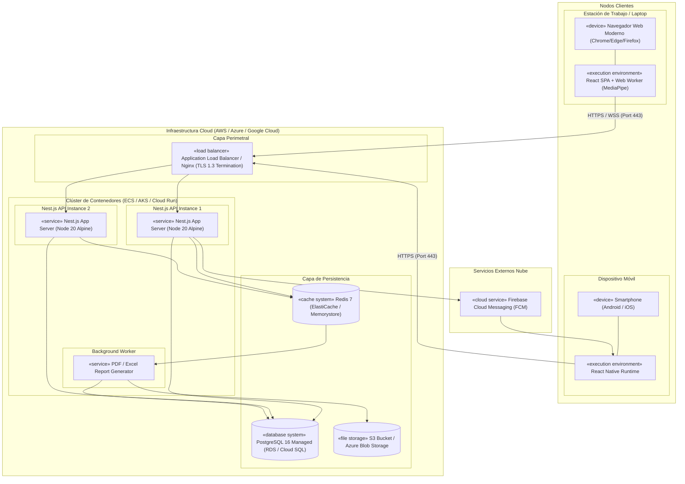
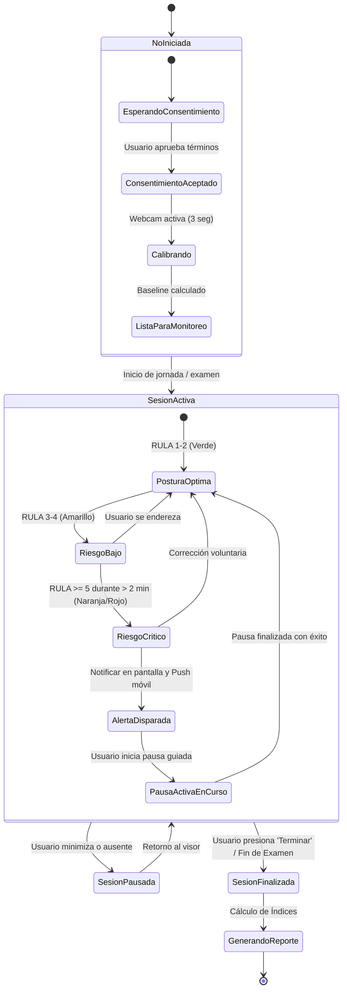
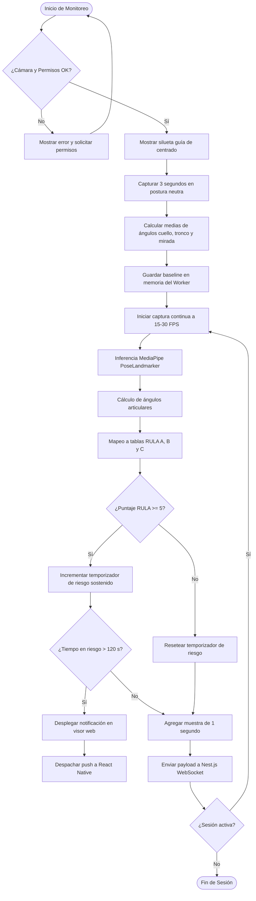
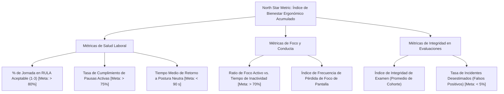

# ErgoCheck AI — Especificación de Requisitos de Software (SRS) y Modelado UML 2.5+

> **Proyecto:** ErgoCheck AI: Plataforma Inteligente de Evaluación Postural y Prevención de Riesgos Ergonómicos en Entornos Laborales Mediante Visión Artificial 2D  
> **Institución:** Universidad Autónoma Gabriel René Moreno (UAGRM)  
> **Facultad:** Facultad de Ingeniería en Ciencias de la Computación y Telecomunicaciones (FICCT)  
> **Materia:** Ingeniería de Software 1 (INF-422) — Grupo #1  
> **Docente:** Ing. Rolando Antonio Martínez Canedo  
> **Gestión:** Semestre 2 - 2026  
> **Metodología de Desarrollo:** SCRUM (Ágil)  
> **Notación de Modelado:** UML 2.5+ (Estándar OMG / Compatible con Enterprise Architect)  
> **Estándar SRS:** ISO/IEC/IEEE 29148:2018  

---

## Integrantes del Grupo #1

| Integrante | Registro |
|---|---|
| Camacho Jimenez Jairo Lisandro | 222053348 |
| Lopez Velazquez Marco Alejandro | 222008891 |
| Matienzo Flores Juan Manuel | 222008970 |
| Moreno Gonzales Jerson Alexander | 221180508 |
| Orellana Escobar Isaac | 222056541 |

---

## Índice General

1. [Marco Metodológico de Trabajo (SCRUM)](#1-marco-metodológico-de-trabajo-scrum)
2. [Introducción y Objetivos del Sistema](#2-introducción-y-objetivos-del-sistema)
3. [Stack Tecnológico Oficial y Arquitectura de Ejecución](#3-stack-tecnológico-oficial-y-arquitectura-de-ejecución)
4. [Modelado Estructural y Comportamental UML 2.5+ (CASE Enterprise Architect)](#4-modelado-estructural-y-comportamental-uml-25-case-enterprise-architect)
   - 4.1 Diagrama de Casos de Uso (UML Use Case Diagram)
   - 4.2 Diagrama de Clases de Diseño (UML Class Diagram)
   - 4.3 Diagrama de Secuencia: Inferencia Local y Telemetría WebSocket (UML Sequence Diagram)
   - 4.4 Diagrama de Componentes del Sistema (UML Component Diagram)
   - 4.5 Diagrama de Despliegue en la Nube (UML Deployment Diagram)
   - 4.6 Diagrama de Estados: Ciclo de Vida de la Sesión y Riesgo Ergonómico (UML State Machine)
   - 4.7 Diagrama de Actividades: Calibración y Evaluación RULA (UML Activity Diagram)
5. [Especificación de Requisitos Funcionales (Product Backlog / User Stories)](#5-especificación-de-requisitos-funcionales-product-backlog--user-stories)
6. [Requisitos No Funcionales y Atributos de Calidad](#6-requisitos-no-funcionales-y-atributos-de-calidad)
7. [Diseño de Base de Datos Relacional y Series Temporales (PostgreSQL)](#7-diseño-de-base-de-datos-relacional-y-series-temporales-postgresql)
8. [Contratos de Interfaz (Nest.js REST API & WebSocket Gateway)](#8-contratos-de-interfaz-nestjs-rest-api--websocket-gateway)
9. [Lógica Algorítmica y Matemáticas del Sistema](#9-lógica-algorítmica-y-matemáticas-del-sistema)
10. [Análisis de Amenazas (STRIDE) y Seguridad DevSecOps](#10-análisis-de-amenazas-stride-y-seguridad-devsecops)
11. [Marco Ético, Privacidad y Cumplimiento Normativo (GDPR / AI Act / Ley Boliviana)](#11-marco-ético-privacidad-y-cumplimiento-normativo-gdpr--ai-act--ley-boliviana)
12. [Cuadro de Mando de KPIs (Business Intelligence)](#12-cuadro-de-mando-de-kpis-business-intelligence)
13. [Plan de Sprints (Release Plan SCRUM)](#13-plan-de-sprints-release-plan-scrum)
14. [Matriz de Trazabilidad de Requisitos](#14-matriz-de-trazabilidad-de-requisitos)

---

## 1. Marco Metodológico de Trabajo (SCRUM)

Para la ejecución de ErgoCheck AI se adopta **SCRUM** como marco de trabajo ágil, estructurado para un ciclo académico de 16 semanas:



### 1.1 Ceremonias y Artefactos SCRUM
- **Duración del Sprint:** 2 semanas por Sprint (8 Sprints en total durante la gestión 2-2026).
- **Product Backlog:** Lista priorizada de User Stories descritas en formato estándar: `Como [rol], quiero [acción], para [beneficio]`, con criterios de aceptación en sintaxis Gherkin (`Dado/Cuando/Entonces`).
- **Definición de Hecho (Definition of Done - DoD):**
  1. Código TypeScript con tipado estricto (`noImplicitAny: true`) sin warnings de ESLint.
  2. Pruebas unitarias ejecutadas con éxito (Jest en Nest.js, React Testing Library en React).
  3. Cobertura de pruebas mínima de 80% en lógica de negocio.
  4. Revisión de código (Pull Request) aprobada por al menos un compañero.
  5. Despliegue automático en ambiente de staging en la nube (CI/CD GitHub Actions).
  6. Documentación técnica y diagramas UML actualizados en Enterprise Architect.

---

## 2. Introducción y Objetivos del Sistema

### 2.1 Problema
Las instituciones educativas y empresas carecen de visibilidad objetiva sobre la interacción de los usuarios frente al monitor:
- **Salud Ocupacional:** Trastornos Musculoesqueléticos (TME) causados por posturas viciosas no corregidas a tiempo.
- **Productividad:** Falta de métricas reales sobre tiempo en foco efectivo frente a tiempo ocioso o dispersión en ventanas secundarias.
- **Probidad Académica / Laboral:** Vulnerabilidad en exámenes y pruebas psicotécnicas remotas ante el uso encubierto de dispositivos móviles (en el regazo) o pérdida de foco hacia herramientas no autorizadas.

### 2.2 Objetivos
- **O1:** Implementar evaluación ergonómica RULA en tiempo real mediante visión 2D sin requerir sensores ni hardware especializado.
- **O2:** Detectar patrones de distracción y desvío de mirada (gaze tracking / head pose) con algoritmos vectoriales.
- **O3:** Garantizar privacidad mediante procesamiento *Edge AI*: los fotogramas se procesan y destruyen en la memoria del navegador.
- **O4:** Proveer un ecosistema multiplataforma unificado: aplicación web en **React**, app móvil en **React Native**, y backend de alto rendimiento en **Nest.js**.
- **O5:** Modelar formalmente el sistema bajo la especificación **UML 2.5+ de la OMG** para herramientas CASE como Enterprise Architect.

---

## 3. Stack Tecnológico Oficial y Arquitectura de Ejecución

Siguiendo el estándar fijado para el proyecto:

| Capa | Tecnología | Justificación Técnica |
|---|---|---|
| **Metodología** | **SCRUM** | Desarrollo iterativo e incremental con entregas continuas cada 2 semanas. |
| **Backend** | **Nest.js (Node.js + TypeScript)** | Framework modular empresarial con inyección de dependencias, soporte nativo de WebSockets (`@nestjs/websockets`), Guards para RBAC, DTOs con validación estricta (`class-validator`) y documentación Swagger/OpenAPI. |
| **Frontend Web** | **React 18+ (TypeScript)** | Arquitectura basada en componentes funcionales, Hooks, gestión de estado predecible, integración de Web Workers con `OffscreenCanvas` y diseño responsive con TailwindCSS. |
| **Aplicación Móvil** | **React Native (TypeScript)** | Aplicación nativa multiplataforma (Android e iOS) para visualización de pausas activas, escaneo de código QR para vinculación y recepción de notificaciones push en segundo plano. |
| **Base de Datos** | **PostgreSQL 16** | Sistema de gestión de bases de datos relacional robusto con particionamiento nativo por rangos de tiempo para telemetría, soporte JSONB para metadatos flexibles e integridad ACID estricta. |
| **IA Integrada (Edge & Cloud)** | **MediaPipe Tasks Vision + TensorFlow.js** | Inferencia de visión artificial local (Pose y Face Mesh) compilada en WebAssembly ejecutada en Web Worker. |
| **Infraestructura Cloud** | **AWS / Azure / Google Cloud** | Despliegue en contenedores Docker (AWS ECS / Azure App Service / Google Cloud Run), base de datos gestionada (RDS / Cloud SQL) y almacenamiento de objetos S3 / Blob Storage. |
| **Lenguaje de Modelado** | **UML 2.5+ (OMG Standard)** | Modelado formal para herramientas CASE empresariales como **Enterprise Architect (Sparx Systems)**. |

---

## 4. Modelado Estructural y Comportamental UML 2.5+ (CASE Enterprise Architect)

Este capítulo presenta los diagramas normativos bajo la especificación **UML 2.5 de la OMG (Object Management Group)**, diseñados para su importación directa y trazabilidad en **Enterprise Architect**.

### 4.1 Diagrama de Casos de Uso (UML Use Case Diagram)



### 4.2 Diagrama de Clases de Diseño (UML Class Diagram)
Representa la arquitectura orientada a objetos del backend **Nest.js** (controladores, servicios, entidades y pasarelas de sockets):



### 4.3 Diagrama de Secuencia: Inferencia Local y Telemetría WebSocket (UML Sequence Diagram)



### 4.4 Diagrama de Componentes del Sistema (UML Component Diagram)



### 4.5 Diagrama de Despliegue en la Nube (UML Deployment Diagram)



### 4.6 Diagrama de Estados: Ciclo de Vida de la Sesión y Riesgo Ergonómico (UML State Machine)



### 4.7 Diagrama de Actividades: Calibración y Evaluación RULA (UML Activity Diagram)



---

## 5. Especificación de Requisitos Funcionales (Product Backlog / User Stories)

Las historias de usuario siguen el estándar formal con sus criterios de aceptación:

### Épica 1: Identidad, Tenancy y Consentimiento Digital

#### US-01: Gestión de Tenants y Control de Acceso RBAC
- **Como** Administrador de Organización,
- **Quiero** registrar sedes y usuarios asignando roles específicos (`org_admin`, `supervisor`, `evaluator`, `employee`, `candidate`),
- **Para** asegurar el aislamiento total de datos de acuerdo a nuestra estructura institucional.
- **Criterios de Aceptación (Gherkin):**
  - *Dado* un usuario con rol `employee`, *cuando* intenta invocar rutas administrativas de Nest.js, *entonces* el guard `@Roles()` rechaza con código `403 Forbidden`.
  - *Dado* un supervisor del Tenant A, *cuando* consulta sesiones activas, *entonces* la base de datos PostgreSQL filtra automáticamente mediante `WHERE tenant_id = :currentTenant`.

#### US-02: Consentimiento Informado Digital
- **Como** usuario final (empleado o estudiante),
- **Quiero** revisar una declaración transparente de privacidad antes de iniciar la cámara web,
- **Para** conocer qué datos se procesan localmente y dar mi autorización formal.
- **Criterios de Aceptación:**
  - *Dado* un usuario que ingresa por primera vez, *cuando* no ha firmado la versión vigente del consentimiento, *entonces* el componente React no solicita el stream de video hasta que presiona "Acepto".

---

### Épica 2: Visión Artificial Local (Edge AI) y Evaluación RULA

#### US-03: Inferencia en Web Worker y Destrucción Inmediata de Fotogramas
- **Como** usuario monitoreado,
- **Quiero** que el procesamiento de video se ejecute en mi navegador y destruya los fotogramas al instante,
- **Para** tener la certeza de que mi imagen no viaja por internet ni queda guardada en ningún servidor.
- **Criterios de Aceptación:**
  - *Dado* el flujo continuo de video en el Web Worker, *cuando* concluye la inferencia de MediaPipe, *entonces* el objeto `ImageBitmap` se cierra (`close()`), liberando la memoria.
  - *Dado* el tráfico de red inspeccionado, *cuando* la aplicación transmite datos, *entonces* 0 bytes corresponden a imágenes JPEG, PNG o base64.

#### US-04: Cálculo Continuo de Puntuación Ergonómica RULA
- **Como** trabajador de oficina,
- **Quiero** conocer mi nivel de riesgo postural en tiempo real,
- **Para** corregir malos hábitos antes de que generen dolor o lesiones musculoesqueléticas.
- **Criterios de Aceptación:**
  - *Dado* un usuario con flexión de cuello de 25° y hombros levantados, *cuando* transcurre 1 segundo, *entonces* el algoritmo de React reporta un RULA $\ge 5$.

#### US-05: Detección Vectorial de Mirada al Regazo (Anti-Celular)
- **Como** evaluador o docente,
- **Quiero** identificar desvíos reiterados de la mirada hacia el escritorio o regazo durante un examen,
- **Para** detectar sospechas fundamentadas de consulta de teléfonos celulares o apuntes no permitidos.
- **Criterios de Aceptación:**
  - *Dado* un estudiante en examen, *cuando* baja la cabeza ($\text{Pitch} < -20^\circ$) más de 2 segundos repetidas veces sin actividad de teclado, *entonces* el sistema emite el evento `GAZE_DOWN_SUSTAINED`.

---

### Épica 3: Telemetría de Actividad Digital y Anti-Cheat

#### US-06: Auditoría de Pérdida de Foco y Enforzamiento de Pantalla Completa
- **Como** docente examinador,
- **Quiero** registrar si el estudiante sale de la pantalla completa o cambia de ventana durante la prueba,
- **Para** garantizar condiciones equitativas y transparentes de evaluación.
- **Criterios de Aceptación:**
  - *Dado* un examen en pantalla completa, *cuando* el estudiante presiona `Escape` o cambia de pestaña, *entonces* React emite `FULLSCREEN_EXIT` y `WINDOW_BLUR` cronometrando los milisegundos fuera de foco.

#### US-07: Bloqueo de Acciones del Portapapeles y Teclas Críticas
- **Como** evaluador,
- **Quiero** inhabilitar el copiado, pegado y atajos de inspección en el examen,
- **Para** prevenir la extracción o inserción no autorizada de contenido.
- **Criterios de Aceptación:**
  - *Dado* el área de examen activa, *cuando* el usuario presiona `Ctrl+C` o `Ctrl+V`, *entonces* el evento del teclado es cancelado (`event.preventDefault()`) y se emite `CLIPBOARD_ATTEMPT`.

---

### Épica 4: Prevención Activa y Companion Mobile App (React Native)

#### US-08: Vinculación Rápida Web-Móvil mediante Código QR
- **Como** empleado,
- **Quiero** escanear un código QR desde la app React Native para enlazar mi teléfono celular con mi estación de trabajo,
- **Para** recibir alertas de salud y sincronizar mis pausas activas sin ingresar contraseñas manualmente.
- **Criterios de Aceptación:**
  - *Dado* el visor web abierto, *cuando* la app React Native escanea el QR en pantalla, *entonces* el token temporal se valida en Nest.js y el dispositivo queda registrado para notificaciones push en menos de 3 segundos.

#### US-09: Catálogo y Reproductor Guiado de Pausas Activas
- **Como** trabajador con fatiga o mala postura prolongada,
- **Quiero** seguir rutinas interactivas de estiramiento en mi teléfono móvil,
- **Para** aliviar la tensión muscular y registrar el cumplimiento de mis pausas de descanso.
- **Criterios de Aceptación:**
  - *Dado* un aviso de pausa activa, *cuando* el usuario abre la rutina en React Native, *entonces* la app reproduce la animación guía con temporizador regresivo y reporta `BREAK_COMPLETED` al finalizar.

---

### Épica 5: Dashboard de Supervisión y Reportes Forenses

#### US-10: Consola de Supervisión en Tiempo Real (Mosaico React)
- **Como** supervisor de área o evaluador,
- **Quiero** observar el estado de todos los puestos monitoreados en una cuadrícula viva,
- **Para** detectar inmediatamente situaciones de riesgo ergonómico o incidentes en exámenes.
- **Criterios de Aceptación:**
  - *Dado* un cambio de estado en el backend Nest.js, *cuando* se emite por WebSocket, *entonces* la tarjeta del usuario en React se actualiza visualmente en menos de 2 segundos.

#### US-11: Emisión Asíncrona de Reportes Forenses en PDF y Excel
- **Como** responsable de SST o docente,
- **Quiero** generar informes individuales y corporativos descargables con gráficos de evolución,
- **Para** documentar la trazabilidad ergonómica y el índice de integridad de las sesiones.
- **Criterios de Aceptación:**
  - *Dado* el cierre de una sesión, *cuando* el evaluador presiona "Generar Reporte", *entonces* Nest.js compila el documento PDF oficial con el desglose de incidentes y el índice de integridad final.

---

## 6. Requisitos No Funcionales y Atributos de Calidad

| Código | Atributo | Requisito No Funcional | Métrica de Aceptación |
|---|---|---|---|
| **RNF-01** | **Privacidad** | Inferencia 100% en el cliente sin streaming de imágenes a servidores centrales. | Cero fotogramas transmitidos o almacenados (0 KB de video en la red). |
| **RNF-02** | **Rendimiento Edge** | La inferencia combinada en el Web Worker debe operar a una tasa $\ge 15\text{ FPS}$ en hardware estándar de oficina. | Tasa promedio $\ge 15\text{ FPS}$ en CPU Intel Core i5 de 8.ª gen sin GPU dedicada. |
| **RNF-03** | **Fluidez de UI** | El agente de visión no debe bloquear el hilo principal de React. | INP (Interaction to Next Paint) $\le 200\text{ ms}$; CPU en hilo principal $\le 25\%$. |
| **RNF-04** | **Latencia de Telemetría** | Tiempo desde que ocurre un evento en el navegador hasta que se visualiza en el dashboard administrativo. | Percentil 95 ($p_{95}$) de latencia $\le 2.0\text{ segundos}$. |
| **RNF-05** | **Concurrencia Backend** | El backend Nest.js debe manejar al menos 500 conexiones de telemetría WebSocket simultáneas por nodo. | Pruebas de estrés con Artillery/k6: 500 clientes concurrentes con 1 msg/s, tasa de error $\le 0.1\%$. |
| **RNF-06** | **Seguridad en Tránsito** | Todas las conexiones externas deben operar bajo cifrado TLS 1.3 forzado. | Grado A+ en SSL Labs; rechazo absoluto de HTTP y WS en texto plano. |
| **RNF-07** | **Seguridad en Reposo** | Contraseñas y tokens protegidos con algoritmos resistentes a ataques de fuerza bruta. | Hash de credenciales mediante Argon2id o bcrypt ($cost \ge 12$). |
| **RNF-08** | **Tolerancia a Desconexión**| El cliente web debe almacenar eventos localmente en IndexedDB ante cortes de internet. | Buffer local de hasta 15 minutos; sincronización ordenada e idempotente al reanudar conexión. |
| **RNF-09** | **Accesibilidad** | Interfaces web diseñadas de acuerdo a la normativa WCAG 2.2 Nivel AA. | Cumplimiento validado con herramientas axe-core y soporte para lectores de pantalla. |
| **RNF-10** | **Disponibilidad Cloud** | El servicio backend desplegado en la nube debe ofrecer alta disponibilidad. | Uptime del 99.5% durante periodos activos de monitoreo y exámenes. |

---

## 7. Diseño de Base de Datos Relacional y Series Temporales (PostgreSQL)

El esquema en **PostgreSQL 16** utiliza particionamiento nativo por rango temporal para tablas de alta frecuencia:

```sql
-- Extensión para generación de identificadores universales
CREATE EXTENSION IF NOT EXISTS "pgcrypto";

-- 1. Tabla de Organizaciones (Multi-Tenancy)
CREATE TABLE tenants (
    id UUID PRIMARY KEY DEFAULT gen_random_uuid(),
    name VARCHAR(100) NOT NULL,
    plan_type VARCHAR(50) NOT NULL DEFAULT 'standard',
    retention_days INT NOT NULL DEFAULT 90,
    created_at TIMESTAMPTZ NOT NULL DEFAULT NOW()
);

-- 2. Tabla de Usuarios del Sistema
CREATE TABLE users (
    id UUID PRIMARY KEY DEFAULT gen_random_uuid(),
    tenant_id UUID NOT NULL REFERENCES tenants(id) ON DELETE CASCADE,
    email VARCHAR(255) NOT NULL UNIQUE,
    password_hash VARCHAR(255) NOT NULL,
    full_name VARCHAR(150) NOT NULL,
    role VARCHAR(50) NOT NULL CHECK (role IN ('platform_admin', 'org_admin', 'supervisor', 'evaluator', 'employee', 'candidate')),
    is_active BOOLEAN NOT NULL DEFAULT TRUE,
    created_at TIMESTAMPTZ NOT NULL DEFAULT NOW()
);
CREATE INDEX idx_users_tenant_role ON users(tenant_id, role);

-- 3. Tabla de Consentimientos Informados
CREATE TABLE consents (
    id UUID PRIMARY KEY DEFAULT gen_random_uuid(),
    user_id UUID NOT NULL REFERENCES users(id) ON DELETE CASCADE,
    policy_version VARCHAR(20) NOT NULL,
    accepted BOOLEAN NOT NULL DEFAULT TRUE,
    ip_address INET,
    accepted_at TIMESTAMPTZ NOT NULL DEFAULT NOW()
);

-- 4. Tabla de Sesiones de Monitoreo
CREATE TABLE monitor_sessions (
    id UUID PRIMARY KEY DEFAULT gen_random_uuid(),
    tenant_id UUID NOT NULL REFERENCES tenants(id),
    user_id UUID NOT NULL REFERENCES users(id),
    exam_id UUID,
    mode VARCHAR(20) NOT NULL CHECK (mode IN ('corporate', 'assessment')),
    status VARCHAR(20) NOT NULL DEFAULT 'active' CHECK (status IN ('active', 'completed', 'aborted')),
    started_at TIMESTAMPTZ NOT NULL DEFAULT NOW(),
    ended_at TIMESTAMPTZ,
    baseline_calibration JSONB,
    integrity_index NUMERIC(5,2),
    wellbeing_index NUMERIC(5,2)
);
CREATE INDEX idx_sessions_tenant_status ON monitor_sessions(tenant_id, status);

-- 5. Tabla de Muestras de Métricas (Particionada por Rango de Fecha)
CREATE TABLE metric_samples (
    recorded_at TIMESTAMPTZ NOT NULL,
    session_id UUID NOT NULL REFERENCES monitor_sessions(id) ON DELETE CASCADE,
    rula_score SMALLINT NOT NULL CHECK (rula_score BETWEEN 1 AND 7),
    neck_angle_deg REAL,
    trunk_angle_deg REAL,
    head_pitch_deg REAL,
    head_yaw_deg REAL,
    face_detected BOOLEAN NOT NULL DEFAULT TRUE,
    face_count SMALLINT NOT NULL DEFAULT 1,
    blink_rate_bpm REAL,
    PRIMARY KEY (recorded_at, session_id)
) PARTITION BY RANGE (recorded_at);

-- Partición de ejemplo para el mes en curso
CREATE TABLE metric_samples_2026_10 PARTITION OF metric_samples
    FOR VALUES FROM ('2026-10-01 00:00:00+00') TO ('2026-11-01 00:00:00+00');
CREATE INDEX idx_samples_session_time ON metric_samples(session_id, recorded_at DESC);

-- 6. Tabla de Eventos de Actividad
CREATE TABLE activity_events (
    id UUID PRIMARY KEY DEFAULT gen_random_uuid(),
    session_id UUID NOT NULL REFERENCES monitor_sessions(id) ON DELETE CASCADE,
    recorded_at TIMESTAMPTZ NOT NULL DEFAULT NOW(),
    event_type VARCHAR(50) NOT NULL,
    payload JSONB
);
CREATE INDEX idx_events_session_type ON activity_events(session_id, event_type);

-- 7. Tabla de Incidentes Detectados por el Motor de Reglas
CREATE TABLE incidents (
    id UUID PRIMARY KEY DEFAULT gen_random_uuid(),
    session_id UUID NOT NULL REFERENCES monitor_sessions(id) ON DELETE CASCADE,
    rule_code VARCHAR(50) NOT NULL,
    severity VARCHAR(20) NOT NULL CHECK (severity IN ('INFO', 'LOW', 'MEDIUM', 'HIGH', 'CRITICAL')),
    explanation TEXT NOT NULL,
    review_status VARCHAR(20) NOT NULL DEFAULT 'pending' CHECK (review_status IN ('pending', 'confirmed', 'dismissed')),
    reviewer_notes TEXT,
    created_at TIMESTAMPTZ NOT NULL DEFAULT NOW()
);
CREATE INDEX idx_incidents_session_severity ON incidents(session_id, severity);

-- 8. Dispositivos Móviles Registrados para Push (React Native)
CREATE TABLE user_devices (
    id UUID PRIMARY KEY DEFAULT gen_random_uuid(),
    user_id UUID NOT NULL REFERENCES users(id) ON DELETE CASCADE,
    fcm_token TEXT NOT NULL,
    platform VARCHAR(20) NOT NULL CHECK (platform IN ('android', 'ios')),
    updated_at TIMESTAMPTZ NOT NULL DEFAULT NOW()
);
```

---

## 8. Contratos de Interfaz (Nest.js REST API & WebSocket Gateway)

### 8.1 API RESTful (`/api/v1`) — Documentación Swagger

```typescript
// DTOs de validación con class-validator en Nest.js
export class StartSessionDto {
  @IsEnum(['corporate', 'assessment'])
  mode: 'corporate' | 'assessment';

  @IsOptional()
  @IsUUID()
  examId?: string;

  @IsObject()
  baselineCalibration: {
    avgNeckAngle: number;
    avgTrunkAngle: number;
    avgPitch: number;
    avgYaw: number;
  };
}

export class ReviewIncidentDto {
  @IsEnum(['confirmed', 'dismissed'])
  status: 'confirmed' | 'dismissed';

  @IsString()
  @MinLength(5)
  reviewerNotes: string;
}
```

#### Principales Endpoints del Sistema:
- `POST /api/v1/auth/login`: Autentica credenciales y emite tokens JWT.
- `POST /api/v1/sessions`: Inicializa sesión y valida baseline de calibración.
- `PATCH /api/v1/sessions/:id/end`: Finaliza sesión y consolida métricas.
- `GET /api/v1/sessions/live`: Lista sesiones activas con indicadores de semáforo.
- `GET /api/v1/sessions/:id/timeline`: Retorna línea temporal de eventos e incidentes.
- `PATCH /api/v1/incidents/:id/review`: Permite al docente/supervisor validar o desestimar incidencias.
- `POST /api/v1/reports/pdf`: Dispara la generación del reporte formal.
- `POST /api/v1/devices/register`: Registra el token de Firebase desde React Native.

### 8.2 Pasarela de Sockets: `TelemetryGateway` (@nestjs/websockets)

- **Namespace:** `/telemetry`
- **Autenticación:** Handshake con validación de cabecera `Authorization: Bearer <jwt>`.

```typescript
@WebSocketGateway({ namespace: '/telemetry', cors: { origin: '*' } })
export class TelemetryGateway implements OnGatewayConnection, OnGatewayDisconnect {
  @WebSocketServer()
  server: Server;

  @SubscribeMessage('telemetry_sample')
  handleSample(
    @ConnectedSocket() client: Socket,
    @MessageBody() data: TelemetrySampleDto,
  ): void {
    // Procesamiento asíncrono y persistencia en PostgreSQL
  }

  @SubscribeMessage('telemetry_event')
  handleEvent(
    @ConnectedSocket() client: Socket,
    @MessageBody() data: ActivityEventDto,
  ): void {
    // Disparo inmediato a motor de correlación
  }
}
```

---

## 9. Lógica Algorítmica y Matemáticas del Sistema

### 9.1 Trigonometría de Articulaciones para RULA
Dados tres puntos articulares normalizados en el plano 2D: $A$ (extremo), $B$ (articulación vértice) y $C$ (referencia):
$$\vec{u} = \begin{pmatrix} x_A - x_B \\ y_A - y_B \end{pmatrix}, \quad \vec{v} = \begin{pmatrix} x_C - x_B \\ y_C - y_B \end{pmatrix}$$
$$\theta = \arccos\left(\frac{\vec{u} \cdot \vec{v}}{\|\vec{u}\| \|\vec{v}\|}\right) \times \frac{180}{\pi}$$

- **Ángulo de Flexión de Cuello ($\theta_{\text{cuello}}$):** Medido entre el vector *Oreja Media $\to$ Hombro Medio* y el eje vertical inferior.
- **Ángulo de Inclinación de Tronco ($\theta_{\text{tronco}}$):** Medido entre *Hombro Medio $\to$ Cadera Media* y el eje vertical.
- **Riesgo RULA:** Mapeo de $\theta_{\text{cuello}}$ y $\theta_{\text{tronco}}$ a la Tabla B de RULA; si la postura permanece estática sin variación $> \pm 3^\circ$ por más de 60 segundos, se adiciona $+1$ al puntaje de carga estática.

### 9.2 Estimación de Orientación de Cabeza y Mirada (Anti-Celular)
1. **Pitch de Cabeza:** Descomposición angular de la matriz de rotación de MediaPipe FaceLandmarker.
2. **Posición del Iris:** Cociente de altura del centro del iris respecto al contorno palpebral:
   $$G_y = \frac{y_{\text{iris}} - y_{\text{párpado\_sup}}}{y_{\text{párpado\_inf}} - y_{\text{párpado\_sup}}}$$
3. **Ángulo de Mirada Combinado:**
   $$\theta_{\text{mirada}} = \text{Pitch} + \beta \cdot (G_y - 0.5)$$
4. **Regla de Disparo:** Si $\theta_{\text{mirada}} < -20^\circ$ de manera continua durante $\ge 2.0\text{ s}$ sin actividad en el teclado, se cataloga como evento sospechoso de dispositivo en regazo.

---

## 10. Análisis de Amenazas (STRIDE) y Seguridad DevSecOps

| Categoría | Amenaza | Contramedida en la Arquitectura |
|---|---|---|
| **Spoofing** | Uso de cámara virtual para simular asistencia con video grabado. | Detección de drivers virtuales en el navegador, análisis de microparpadeo dinámico y preguntas de confirmación aleatorias. |
| **Tampering** | Alteración manual de payloads JSON en el socket para ocultar mala postura o blur. | Validación de secuencia con timestamps monótonos en Nest.js y firmas de integridad de sesión. |
| **Repudiation** | Desconocimiento del usuario sobre advertencias ergonómicas o incidentes. | Bitácora inmutable en base de datos (`audit_logs`) con identificador de sesión y registro de consentimientos. |
| **Information Disclosure** | Captura no autorizada de imágenes íntimas del usuario en su hogar. | **Arquitectura Zero-Image:** Los frames se destruyen en RAM; ningún pixel viaja por la red. |
| **Denial of Service** | Inundación de sockets con mensajes falsos para saturar el servidor. | Rate limiter estricto en Nest.js (`@nestjs/throttler`): máximo 2 mensajes por segundo por conexión. |
| **Elevation of Privilege** | Empleado accede a la API de reportes de otro compañero. | Guards de Nest.js basados en JWT donde se valida que el `tenant_id` y `user_id` coincidan con el recurso. |

---

## 11. Marco Ético, Privacidad y Cumplimiento Normativo (GDPR / AI Act / Ley Boliviana)

1. **Minimización de Datos (GDPR Art. 5.1.c):** Se transmiten únicamente vectores numéricos derivados (ángulos y contadores). La biometría facial identificatoria (1:N) está prohibida en el sistema.
2. **Reglamento Europeo de Inteligencia Artificial (EU AI Act 2024/1689):** Prohíbe sistemas que pretendan inferir emociones en el trabajo o educación. ErgoCheck AI **no categoriza emociones ni veracidad**. Cualquier métrica gestual es puramente un diferencial de tensión física respecto a la línea base individual, sin inferencias morales ni sanciones automáticas.
3. **Legislación Boliviana:** Cumplimiento del Art. 21.2 de la Constitución Política del Estado (derecho a la privacidad y propia imagen) y la Ley General de Higiene, Seguridad Ocupacional y Bienestar (DL 16998) en cuanto a prevención de enfermedades del trabajo.

---

## 12. Cuadro de Mando de KPIs (Business Intelligence)



---

## 13. Plan de Sprints (Release Plan SCRUM)

El proyecto se planifica en **8 Sprints de 2 semanas** para cubrir el semestre académico:

```mermaid
gantt
    title Plan de Sprints SCRUM - ErgoCheck AI (Gestión 2-2026)
    dateFormat  YYYY-MM-DD
    section Fase Inicial
    Sprint 1 : Definición, Modelado UML y Setup Inicial   :2026-08-10, 14d
    Sprint 2 : Auth Nest.js, RBAC y Captura Web React     :2026-08-24, 14d
    section Núcleo Técnico
    Sprint 3 : Pipeline MediaPipe Worker & RULA 2D        :2026-09-07, 14d
    Sprint 4 : WebSocket Gateway & Telemetría React       :2026-09-21, 14d
    section Proctoring & Móvil
    Sprint 5 : Gaze Tracking, Exámenes & Anti-Cheat       :2026-10-05, 14d
    Sprint 6 : App React Native & Pausas Activas          :2026-10-19, 14d
    section Consolidación
    Sprint 7 : Dashboard Mosaico & Generador de Reportes  :2026-11-02, 14d
    Sprint 8 : Pruebas de Carga, Seguridad & Entrega      :2026-11-16, 14d
```

| Sprint | Épicas e Historias Cubiertas | Entregable Verificable al Docente |
|---|---|---|
| **Sprint 1** | Modelado UML 2.5 en Enterprise Architect, backlog refinado, repositorio monorepo / multi-repo configurado. | Documento SRS y archivo `.eapx` / diagramas UML exportados. |
| **Sprint 2** | US-01, US-02: Auth Nest.js (JWT), base de datos PostgreSQL y pantalla de consentimiento en React. | Login funcional con roles y consentimiento auditado. |
| **Sprint 3** | US-03, US-04: Web Worker con MediaPipe Pose, cálculo trigonométrico y calificación RULA local. | Demo del visor web mostrando esqueleto y puntaje RULA en vivo. |
| **Sprint 4** | Ingesta WebSocket en Nest.js, persistencia de muestras por segundo y monitor de conexión. | Telemetría fluyendo desde React hacia PostgreSQL vía sockets. |
| **Sprint 5** | US-05, US-06, US-07: FaceLandmarker, gaze tracking, detección de mirada al regazo y fullscreen. | Módulo de examen con detección de celular y pérdidas de foco. |
| **Sprint 6** | US-08, US-09: App React Native, escaneo QR de sesión, notificaciones push y pausas interactivas. | App móvil sincronizada recibiendo alertas de mala postura. |
| **Sprint 7** | US-10, US-11: Dashboard administrativo en React (mosaico en vivo) y generación de reportes en PDF. | Consola de supervisión con actualización en vivo y descarga de PDF. |
| **Sprint 8** | RNF-01 al RNF-10: Pruebas unitarias, análisis de vulnerabilidades, pruebas de carga y cierre. | Sistema integrado desplegado en la nube listo para defensa. |

---

## 14. Matriz de Trazabilidad de Requisitos

| Requisito Original de la Propuesta | Historia de Usuario SCRUM | Diagrama UML Asociado | Prueba Automatizada |
|---|---|---|---|
| Estimación de Pose y Ergonomía RULA | US-03, US-04 | Diagrama de Actividades / Clases | `rula.service.spec.ts` |
| Detección de Mirada y Foco (Anti-Celular) | US-05 | Diagrama de Secuencia | `gaze.service.spec.ts` |
| Destrucción Inmediata de Fotogramas | US-03 | Diagrama de Componentes | Test de fugas de memoria y red |
| Telemetría de Foco y Pantalla Completa | US-06, US-07 | Diagrama de Casos de Uso | `telemetry.e2e-spec.ts` |
| App Móvil de Pausas Activas | US-08, US-09 | Diagrama de Despliegue | Test de componentes React Native |
| Consola de Supervisión en Tiempo Real | US-10 | Diagrama de Estados / Mosaico | Test de integración WebSocket |
| Reportes Forenses PDF/Excel | US-11 | Diagrama de Clases | Test de compilación PDF |
