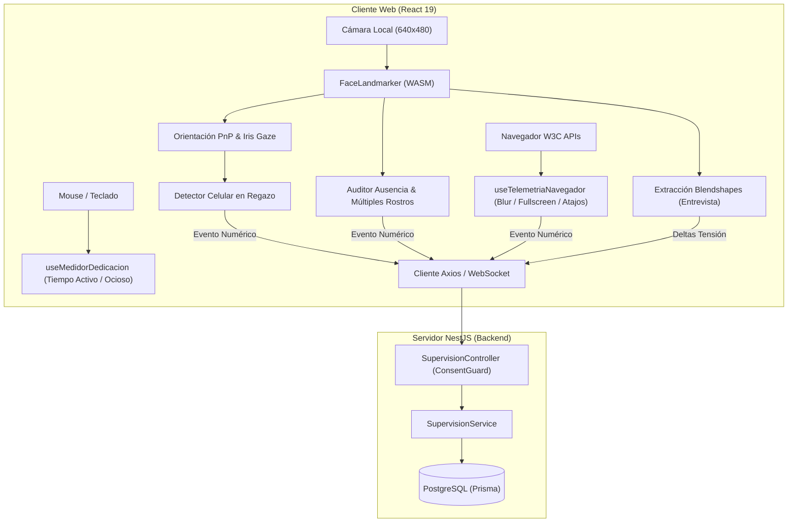

# Design: Sprint 3 — Supervisión de Conducta, Anti-Cheat, Exámenes y Entrevistas

## Arquitectura de Solución (Edge-to-Cloud)

El incremento de Sprint 3 mantiene el principio **Zero-Image Retention**: toda la inferencia sobre el rostro se realiza en la memoria RAM del cliente mediante `MediaPipe FaceLandmarker`. Hacia el backend solo se transmiten eventos numéricos categorizados con marcas de tiempo.

## Reglas Matemáticas y Algoritmos

1. **Pitch Efectivo y Celular en Regazo (CU12):**
   $$\text{Pitch}_{\text{efectivo}} = \text{Pitch} + 0.65 \cdot (G_y - 0.5) \cdot 60^\circ$$
   Condición de activación:
   - $\text{Pitch}_{\text{efectivo}} < -20^\circ$ sostenido $> 2.0\text{ s}$.
   - $\text{keyCount} = 0$.
   - $\ge 3$ ocurrencias en ventana deslizante de 60 segundos.

2. **Auditoría de Presencia Facial (CU13):**
   - `FACE_ABSENT`: 0 rostros durante $> 5.0\text{ s}$.
   - `MULTIPLE_FACES`: $\ge 2$ rostros durante $> 1.0\text{ s}$.

3. **Modo Entrevista (CU18, CU19):**
   - El evaluador dispara una pregunta; el visor despliega la tarjeta flotante y abre una ventana de 5 segundos.
   - Variación de tensión facial:
     $$\Delta b_{\text{tensión}} = \left(\frac{b_{\text{browDownLeft}} + b_{\text{browDownRight}}}{2}\right) - \text{baseline}_{\text{tensión}}$$
   - Latencia de respuesta = $\text{Timestamp}_{\text{primer gesto}} - \text{Timestamp}_{\text{pregunta}}$.
